# Routing analysis

Logs are `routing_analysis.json` in each run directory. Figures below are generated from those dumps.

## How to read the figures

Every **scene** figure is the same layout: **baseline | flat MoE | tree MoE**, color head only.

| Panel | Meaning |
|---|---|
| Entropy *H* | Mean per-sample gate entropy. 0 = the router always picks the same expert(s). ~2.08 = uniform over 8 experts (dense warmup). |
| Heatmap | Routing mass of each leaf over training. Darker = more mass. Gray = leaf not grown yet. |
| Final mass | Share of gates on each leaf at 30k. *n* = leaf count. CV = imbalance (0 = equal, high = a few leaves dominate). |

- **baseline** — shared MLP, 1 expert, no routing. Included as a control.
- **flat MoE** — 8 experts, dense softmax warmup, then Top-2.
- **tree MoE** — starts at 8 leaves (1:1 from flat MoE), grows at 6k / 10k / 14k / 18k; color typically ends at 11 leaves.

Click **opacity / cov / color pages** under a scene for the same three panels on all heads of one method.

Grow-count ablation (`moe_max_total_grows` = 0 / 2 / 4): see [ablate_tree_grows.md](ablate_tree_grows.md).

Dynamic tree topology over training (ASCII): see [tree_growth_txt/INDEX.md](tree_growth_txt/INDEX.md).

Conceptual growth mechanism (ASCII): [tree_growth_concept.txt](tree_growth_concept.txt) · **Detailed (all branches):** [tree_growth_concept_detailed.txt](tree_growth_concept_detailed.txt) · PNG: [tree_growth_concept_detailed.png](tree_growth_concept_detailed.png)

## Anchor feature clustering (Scaffold-GS Fig. 6 protocol)

K-means \(K=3\) on stored \(f_v\in\mathbb{R}^{32}\), anchors colored in 3D. Same scene as Lu et al.\ (`playroom`) plus `kitchen` / `bonsai`. Script: `scripts/plot_anchor_feature_clustering.py`.

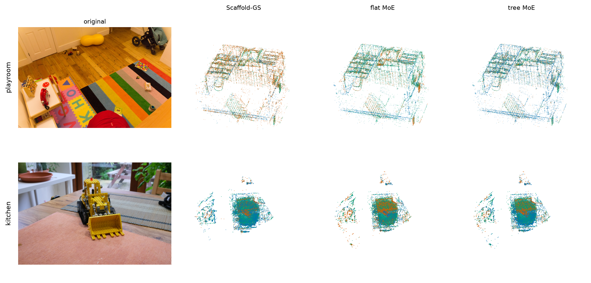

**Figure.** Floor/wall vs furniture groups survive MoE training. NMI(k-means, color router): flat MoE 0.70 / 0.49 / 0.54, tree 0.48 / 0.32 / 0.42 (playroom / kitchen / bonsai).

## Suite summaries

### All datasets — paper routing figure

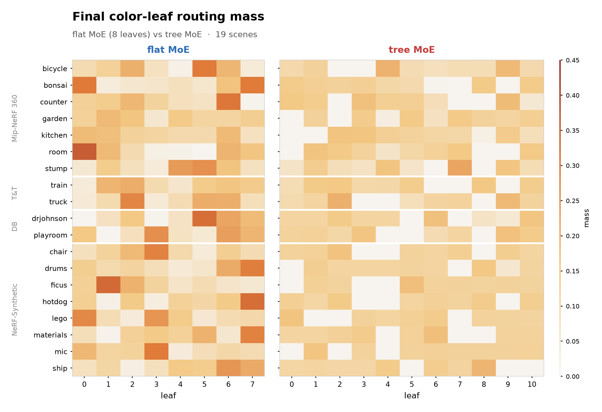

**Figure.** Final color-leaf routing mass on every scene in this project (19: Mip-NeRF 360, Tanks & Temples, Deep Blending, NeRF-Synthetic). Left: flat MoE (8 experts), often peaked on 1–2 leaves. Right: tree MoE (11 leaves); mass spreads after splits and some parent leaves go empty.

### All scenes — final color-head metrics

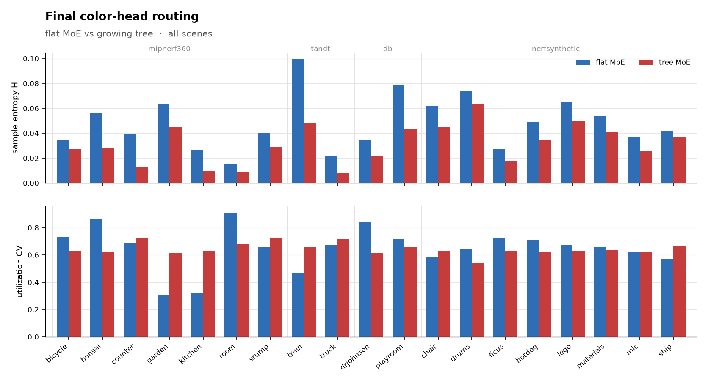

**Figure.** Top: final sample entropy *H* on the color head. Tree MoE is lower than flat MoE on every scene (more specialized routing) even though it has more leaves (11 vs 8). Bottom: utilization CV. Flat MoE is sometimes more balanced (kitchen, garden) and sometimes more collapsed onto one expert (room, bonsai). Tree CV is steadier, typically 0.5–0.7.

### mipnerf360 — entropy over training

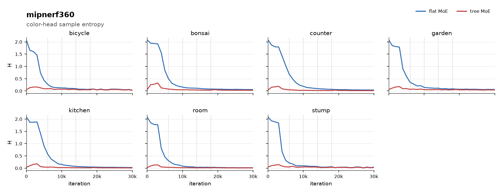

**Figure.** Color-head entropy vs iteration for each mipnerf360 scene. Blue = flat MoE, red = tree MoE. Shared y-axis: flat MoE always shows the dense-warmup plateau near *H*≈2.1, then a collapse after Top-2 turns on (~3–10k). Tree MoE stays near 0, with a small bump around 3k and faint dashed grow lines. Tree MoE wins PSNR on all 7 scenes; largest gains on bonsai (+1.23) and kitchen (+1.00).

### mipnerf360 — final leaf mass

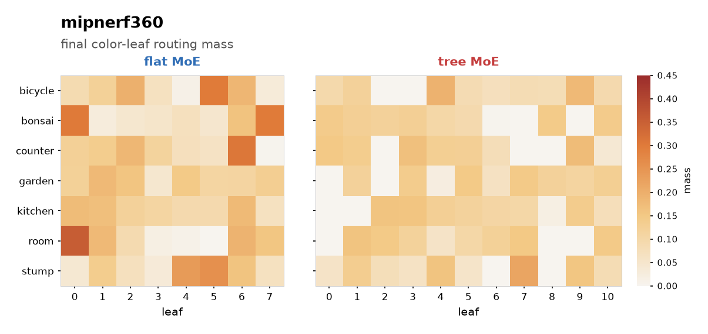

**Figure.** Final color-leaf routing mass. Left: flat MoE, 8 leaves. Right: tree MoE, 11 leaves. Each row is a scene. Darker = that leaf carries more of the gate mass. Flat MoE often dumps mass on 1–2 of the original 8 experts; tree MoE spreads mass over more leaves, and some early leaves go dark after a split (mass moved to children).

### tandt — entropy over training

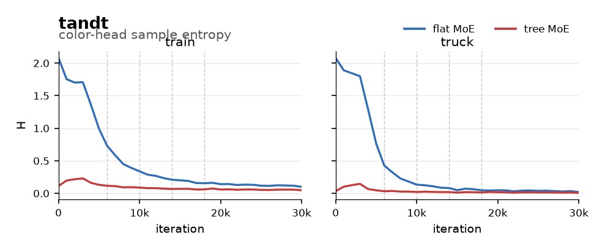

**Figure.** Color-head entropy vs iteration for each tandt scene. Blue = flat MoE, red = tree MoE. Shared y-axis: flat MoE always shows the dense-warmup plateau near *H*≈2.1, then a collapse after Top-2 turns on (~3–10k). Tree MoE stays near 0, with a small bump around 3k and faint dashed grow lines. `train` is the highest-entropy scene in the sweep (flat *H*=0.100); tree still halves it.

### tandt — final leaf mass

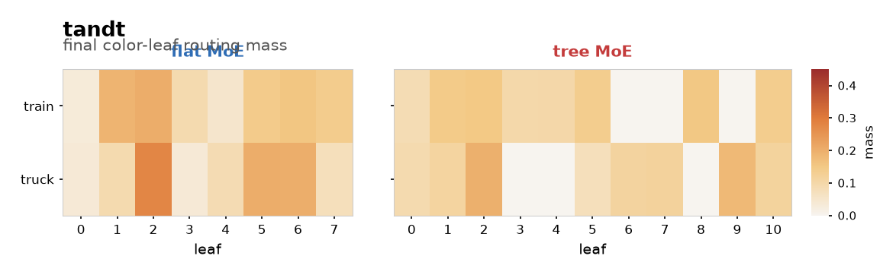

**Figure.** Final color-leaf routing mass. Left: flat MoE, 8 leaves. Right: tree MoE, 11 leaves. Each row is a scene. Darker = that leaf carries more of the gate mass. Flat MoE often dumps mass on 1–2 of the original 8 experts; tree MoE spreads mass over more leaves, and some early leaves go dark after a split (mass moved to children).

### db — entropy over training

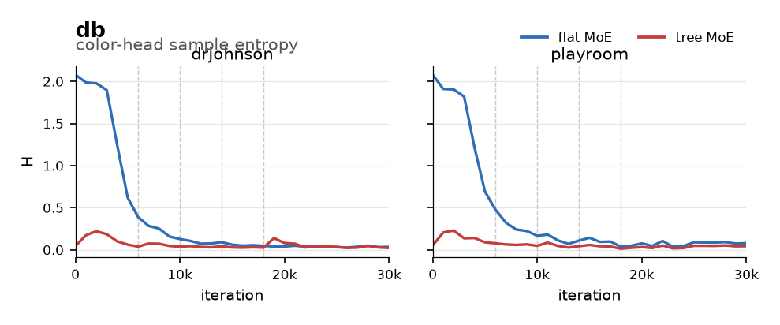

**Figure.** Color-head entropy vs iteration for each db scene. Blue = flat MoE, red = tree MoE. Shared y-axis: flat MoE always shows the dense-warmup plateau near *H*≈2.1, then a collapse after Top-2 turns on (~3–10k). Tree MoE stays near 0, with a small bump around 3k and faint dashed grow lines. Small but consistent PSNR gains; playroom keeps the highest remaining entropy of the indoor pair.

### db — final leaf mass

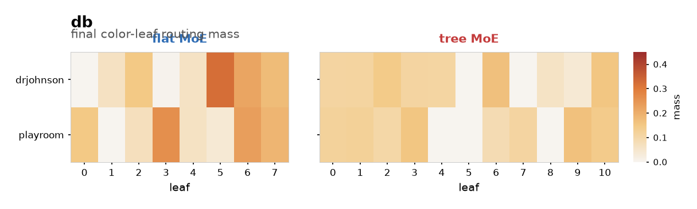

**Figure.** Final color-leaf routing mass. Left: flat MoE, 8 leaves. Right: tree MoE, 11 leaves. Each row is a scene. Darker = that leaf carries more of the gate mass. Flat MoE often dumps mass on 1–2 of the original 8 experts; tree MoE spreads mass over more leaves, and some early leaves go dark after a split (mass moved to children).

### nerfsynthetic — entropy over training

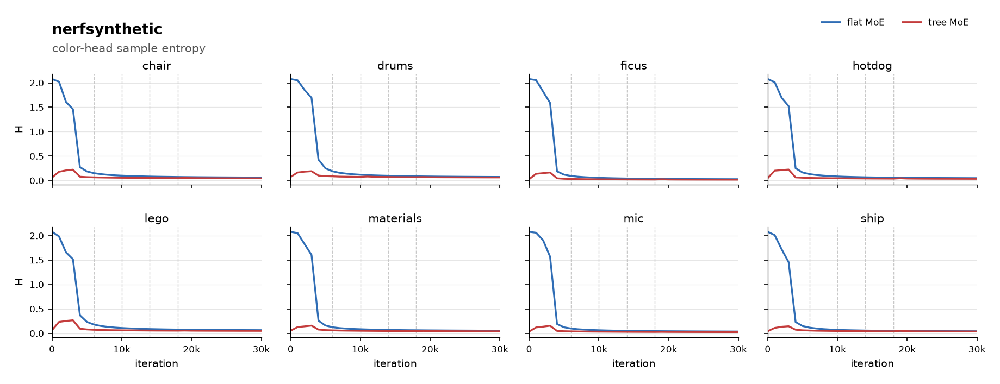

**Figure.** Color-head entropy vs iteration for each nerfsynthetic scene. Blue = flat MoE, red = tree MoE. Shared y-axis: flat MoE always shows the dense-warmup plateau near *H*≈2.1, then a collapse after Top-2 turns on (~3–10k). Tree MoE stays near 0, with a small bump around 3k and faint dashed grow lines. Flat MoE is at or below baseline on most objects; tree recovers on all except ficus (−0.30 vs baseline).

### nerfsynthetic — final leaf mass

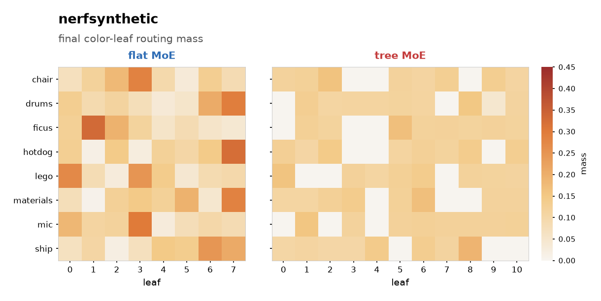

**Figure.** Final color-leaf routing mass. Left: flat MoE, 8 leaves. Right: tree MoE, 11 leaves. Each row is a scene. Darker = that leaf carries more of the gate mass. Flat MoE often dumps mass on 1–2 of the original 8 experts; tree MoE spreads mass over more leaves, and some early leaves go dark after a split (mass moved to children).

## mipnerf360 — per scene

### bicycle

PSNR: baseline 25.14 · flat MoE 25.27 · tree MoE 25.47

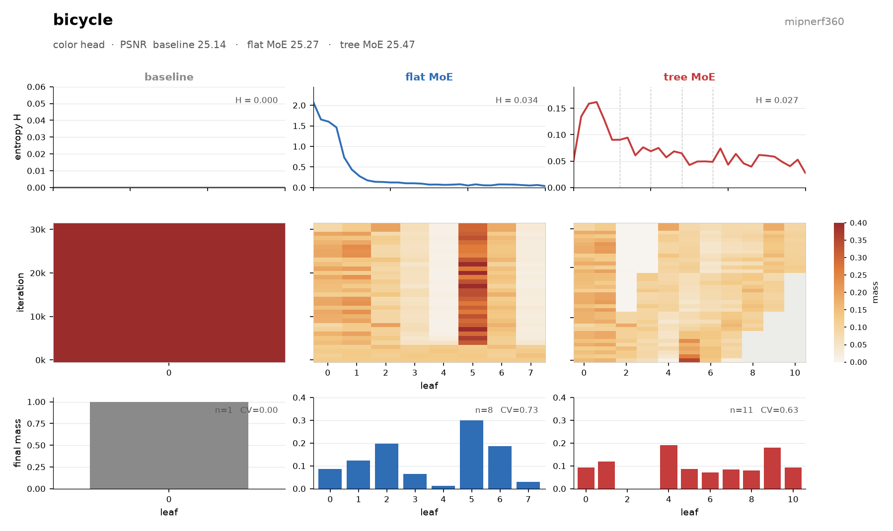

**This scene.** PSNR 25.14 / 25.27 / 25.47 (Δ vs baseline +0.13 / +0.34). Color-head final *H* = 0.034 (8 leaves) vs 0.027 (11 leaves); CV = 0.73 vs 0.63. Best PSNR: tree MoE. tree ends with at least one unused color leaf (parent split, mass moved to children).

opacity / cov / color pages

Same three panels, now one column per **head** (opacity, covariance, color) for a single method. Use these when color-only is not enough — opacity often stays higher-entropy than color, and covariance usually collapses first.

<a href="by_method/mipnerf360/bicycle/moe.png">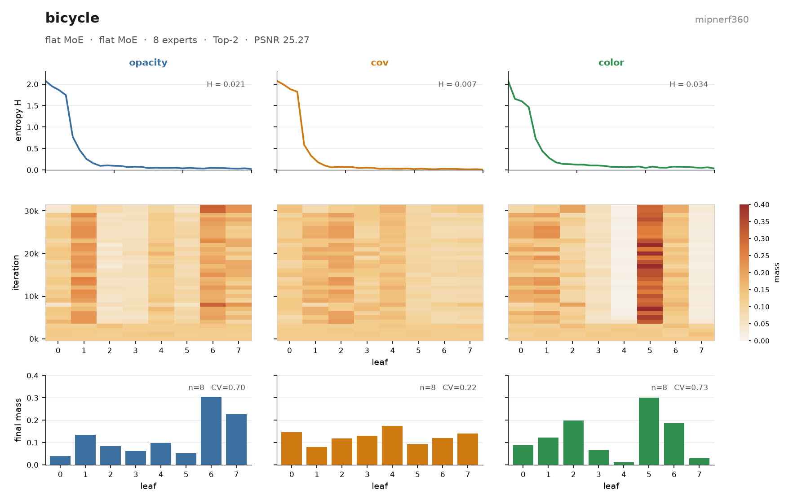</a>
<a href="by_method/mipnerf360/bicycle/moe_tree.png">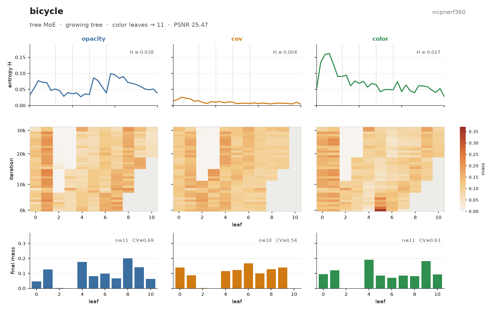</a>

### bonsai

PSNR: baseline 32.52 · flat MoE 33.07 · tree MoE 33.75

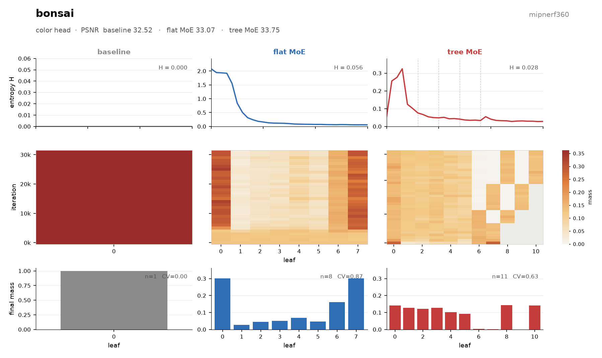

**This scene.** PSNR 32.52 / 33.07 / 33.75 (Δ vs baseline +0.55 / +1.23). Color-head final *H* = 0.056 (8 leaves) vs 0.028 (11 leaves); CV = 0.87 vs 0.63. Best PSNR: tree MoE. flat MoE is peaked (CV=0.87, max leaf 30% of mass); tree ends with at least one unused color leaf (parent split, mass moved to children).

opacity / cov / color pages

Same three panels, now one column per **head** (opacity, covariance, color) for a single method. Use these when color-only is not enough — opacity often stays higher-entropy than color, and covariance usually collapses first.

<a href="by_method/mipnerf360/bonsai/moe.png">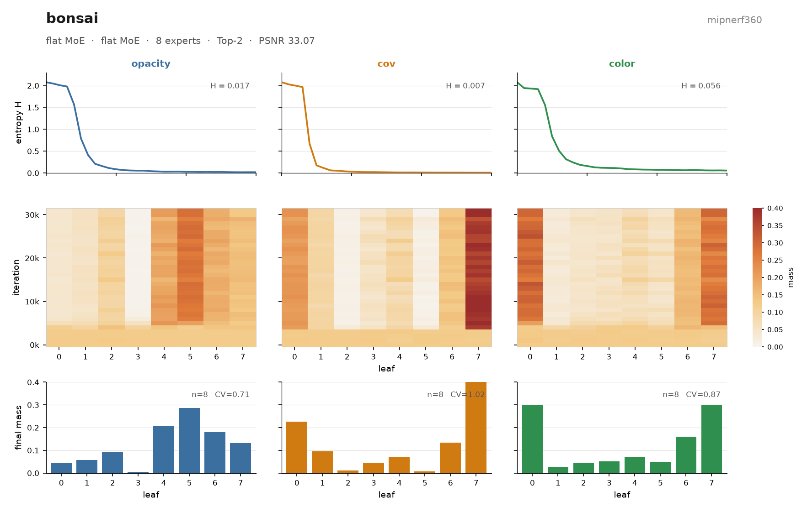</a>
<a href="by_method/mipnerf360/bonsai/moe_tree.png">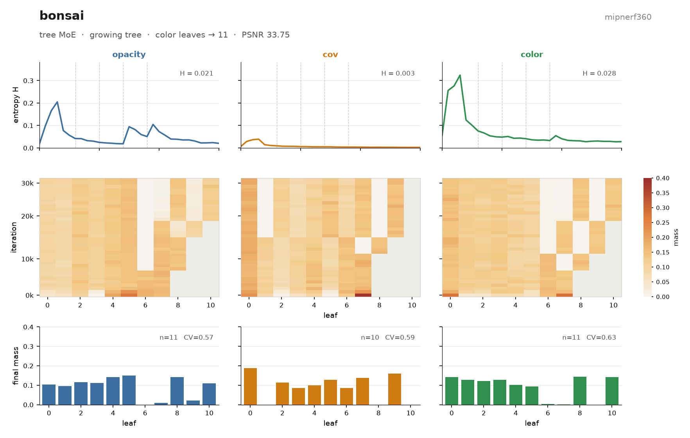</a>

### counter

PSNR: baseline 29.47 · flat MoE 29.66 · tree MoE 30.09

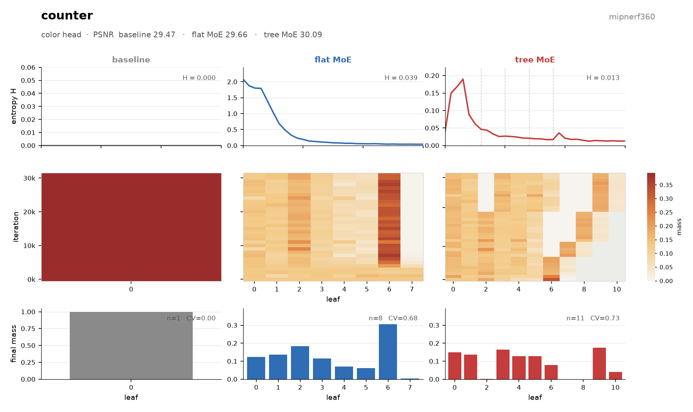

**This scene.** PSNR 29.47 / 29.66 / 30.09 (Δ vs baseline +0.19 / +0.62). Color-head final *H* = 0.039 (8 leaves) vs 0.013 (11 leaves); CV = 0.68 vs 0.73. Best PSNR: tree MoE. tree routing is nearly deterministic (H=0.013).

opacity / cov / color pages

Same three panels, now one column per **head** (opacity, covariance, color) for a single method. Use these when color-only is not enough — opacity often stays higher-entropy than color, and covariance usually collapses first.

<a href="by_method/mipnerf360/counter/moe.png">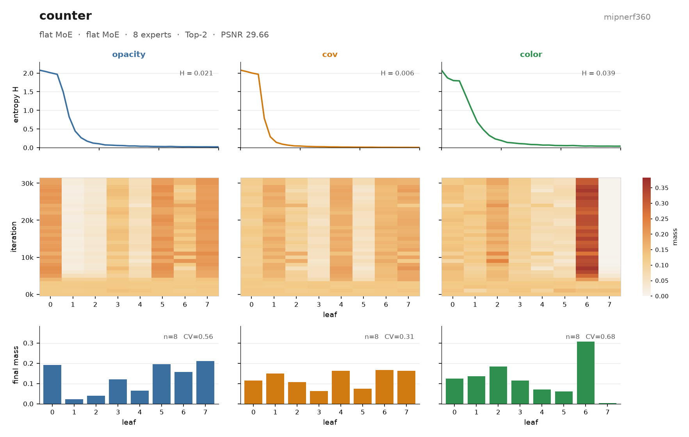</a>
<a href="by_method/mipnerf360/counter/moe_tree.png">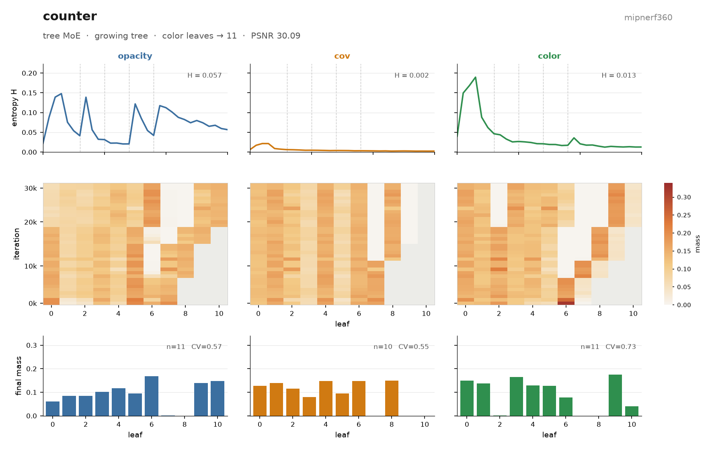</a>

### garden

PSNR: baseline 27.27 · flat MoE 27.44 · tree MoE 27.68

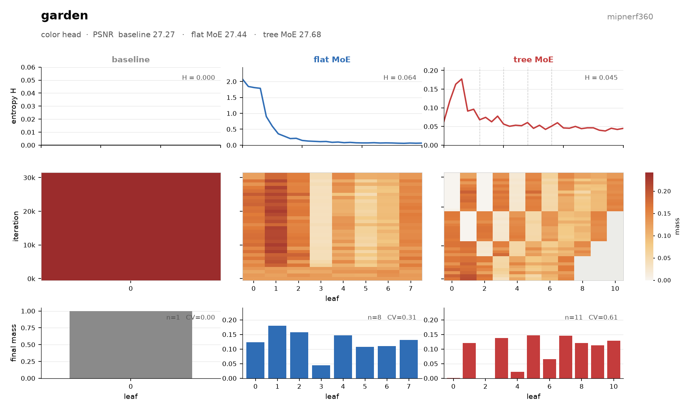

**This scene.** PSNR 27.27 / 27.44 / 27.68 (Δ vs baseline +0.16 / +0.40). Color-head final *H* = 0.064 (8 leaves) vs 0.045 (11 leaves); CV = 0.31 vs 0.61. Best PSNR: tree MoE. tree ends with at least one unused color leaf (parent split, mass moved to children).

opacity / cov / color pages

Same three panels, now one column per **head** (opacity, covariance, color) for a single method. Use these when color-only is not enough — opacity often stays higher-entropy than color, and covariance usually collapses first.

<a href="by_method/mipnerf360/garden/moe.png">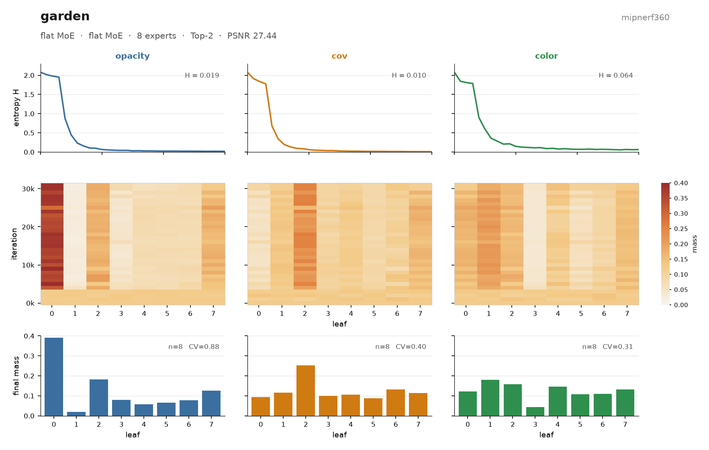</a>
<a href="by_method/mipnerf360/garden/moe_tree.png">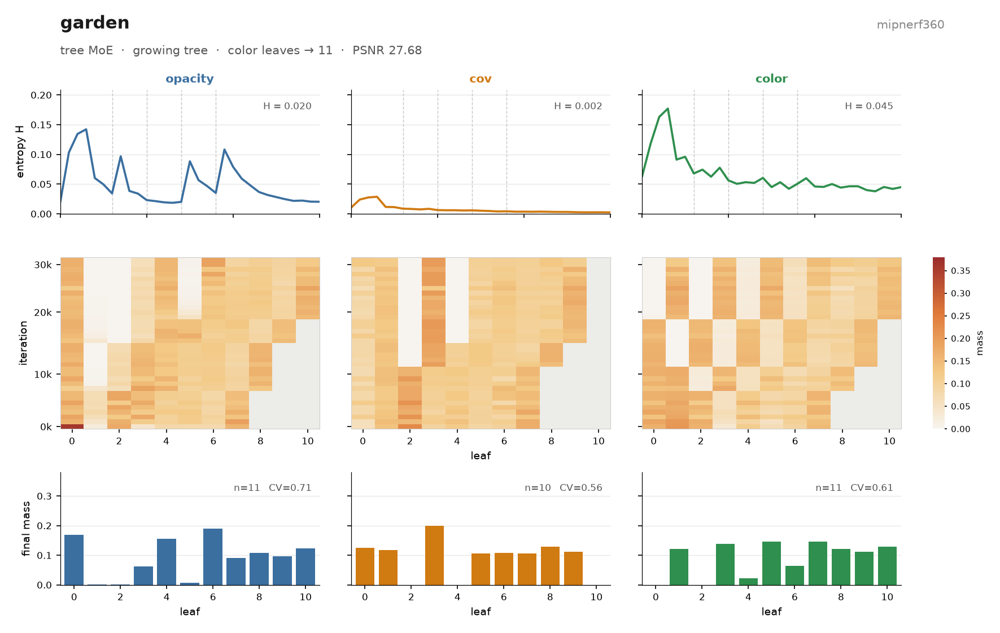</a>

### kitchen

PSNR: baseline 31.24 · flat MoE 31.71 · tree MoE 32.24

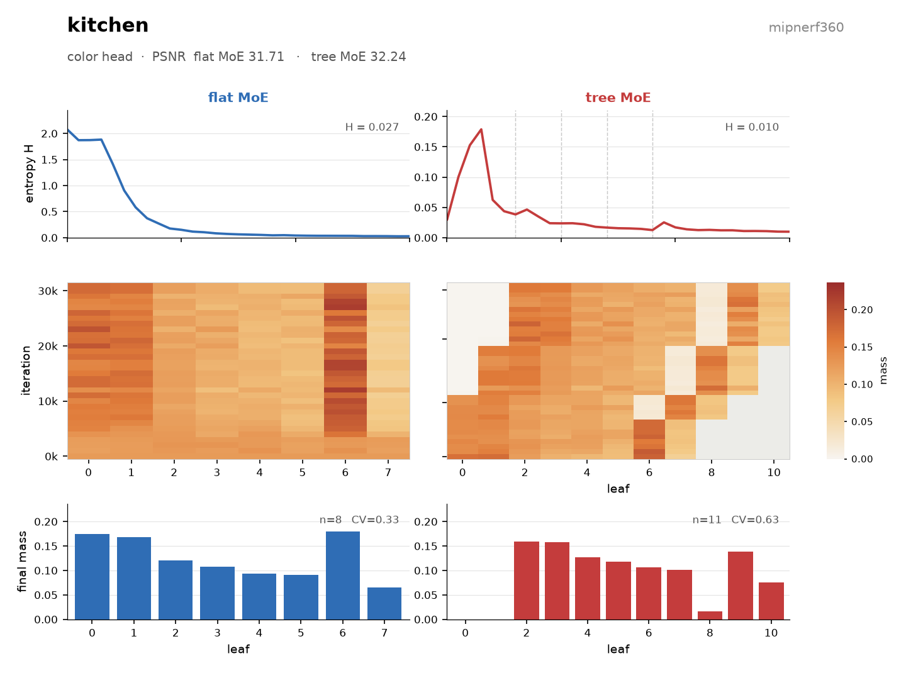

**This scene.** PSNR 31.24 / 31.71 / 32.24 (Δ vs baseline +0.47 / +1.00). Color-head final *H* = 0.027 (8 leaves) vs 0.010 (11 leaves); CV = 0.33 vs 0.63. Best PSNR: tree MoE. tree routing is nearly deterministic (H=0.010); tree ends with at least one unused color leaf (parent split, mass moved to children).

opacity / cov / color pages

Same three panels, now one column per **head** (opacity, covariance, color) for a single method. Use these when color-only is not enough — opacity often stays higher-entropy than color, and covariance usually collapses first.

<a href="by_method/mipnerf360/kitchen/moe.png">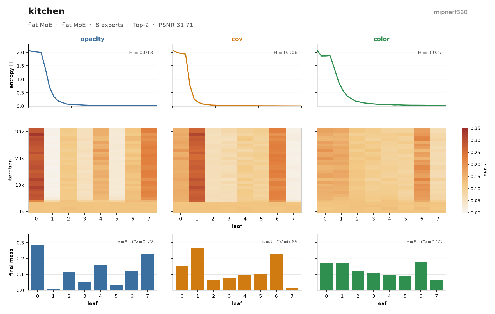</a>
<a href="by_method/mipnerf360/kitchen/moe_tree.png">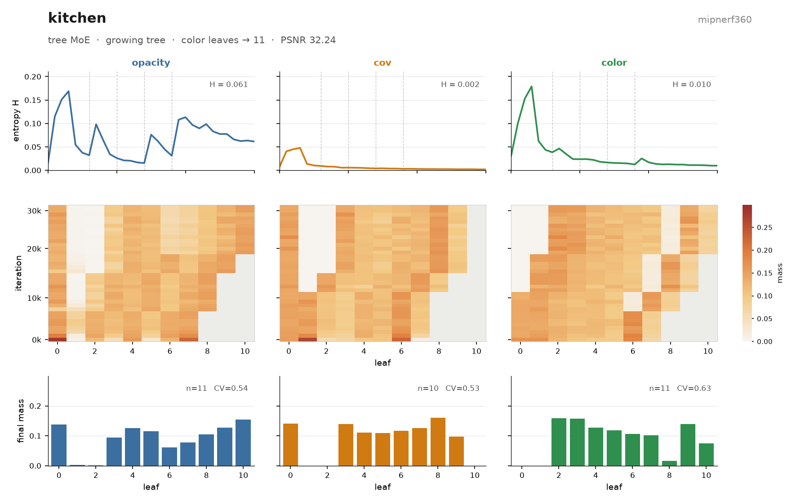</a>

### room

PSNR: baseline 32.10 · flat MoE 32.14 · tree MoE 32.56

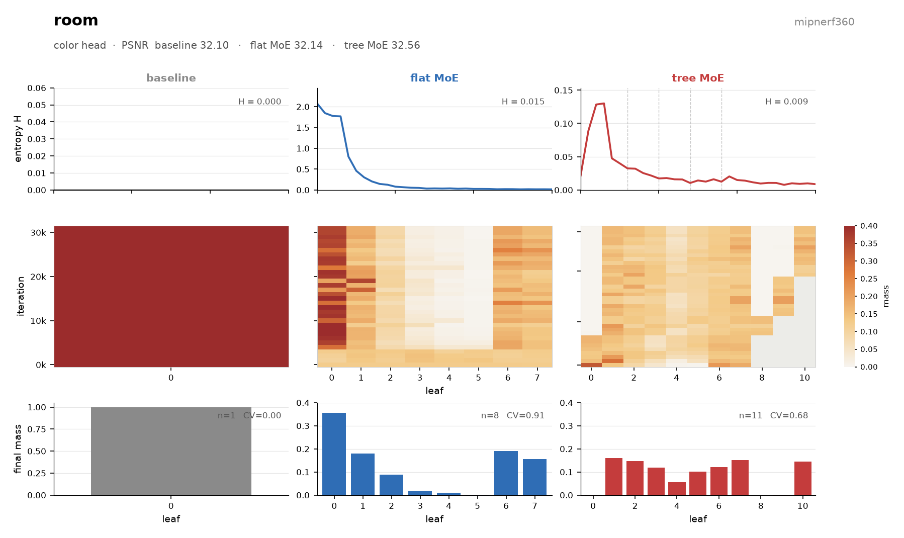

**This scene.** PSNR 32.10 / 32.14 / 32.56 (Δ vs baseline +0.04 / +0.46). Color-head final *H* = 0.015 (8 leaves) vs 0.009 (11 leaves); CV = 0.91 vs 0.68. Best PSNR: tree MoE. tree routing is nearly deterministic (H=0.009); flat MoE is peaked (CV=0.91, max leaf 36% of mass); tree ends with at least one unused color leaf (parent split, mass moved to children).

opacity / cov / color pages

Same three panels, now one column per **head** (opacity, covariance, color) for a single method. Use these when color-only is not enough — opacity often stays higher-entropy than color, and covariance usually collapses first.

<a href="by_method/mipnerf360/room/moe.png">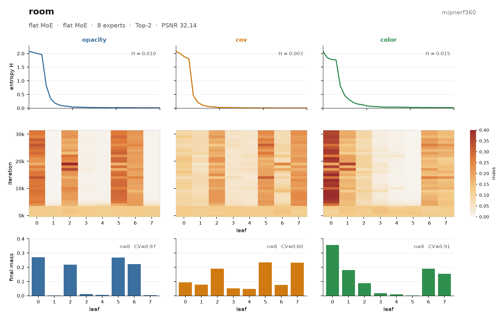</a>
<a href="by_method/mipnerf360/room/moe_tree.png">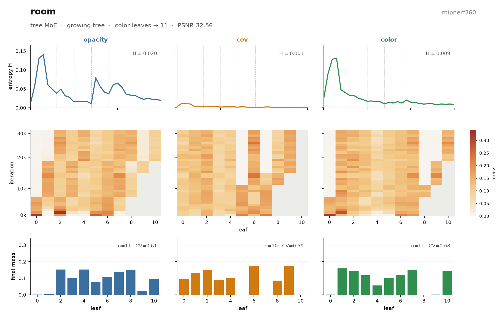</a>

### stump

PSNR: baseline 26.56 · flat MoE 26.66 · tree MoE 26.79

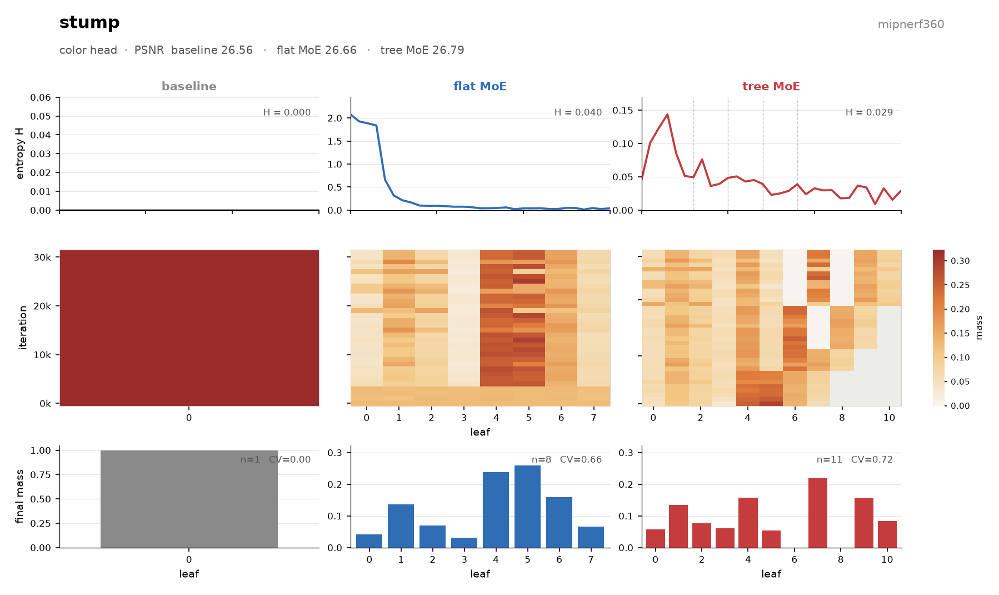

**This scene.** PSNR 26.56 / 26.66 / 26.79 (Δ vs baseline +0.10 / +0.23). Color-head final *H* = 0.040 (8 leaves) vs 0.029 (11 leaves); CV = 0.66 vs 0.72. Best PSNR: tree MoE.

opacity / cov / color pages

Same three panels, now one column per **head** (opacity, covariance, color) for a single method. Use these when color-only is not enough — opacity often stays higher-entropy than color, and covariance usually collapses first.

<a href="by_method/mipnerf360/stump/moe.png">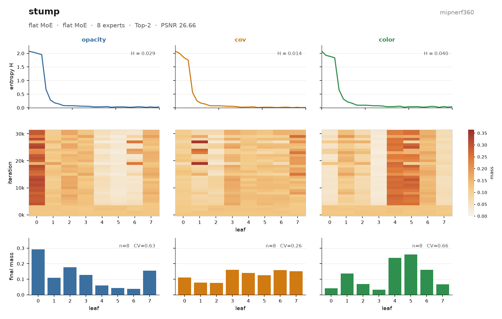</a>
<a href="by_method/mipnerf360/stump/moe_tree.png">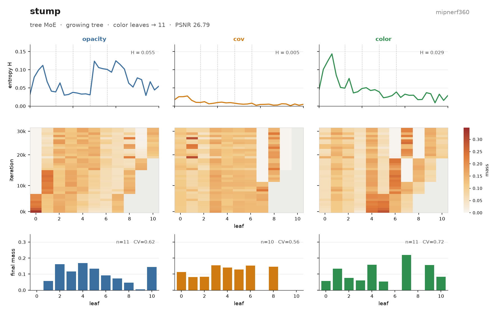</a>

## tandt — per scene

### train

PSNR: baseline 22.34 · flat MoE 22.70 · tree MoE 22.75

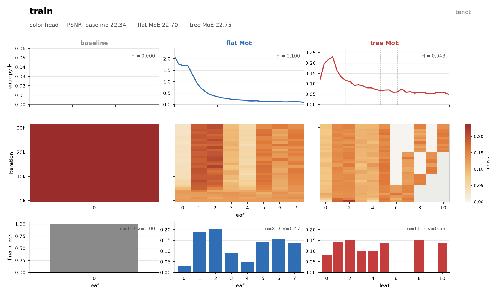

**This scene.** PSNR 22.34 / 22.70 / 22.75 (Δ vs baseline +0.36 / +0.41). Color-head final *H* = 0.100 (8 leaves) vs 0.048 (11 leaves); CV = 0.47 vs 0.66. Best PSNR: tree MoE. flat MoE keeps unusually high final entropy (H=0.100); tree ends with at least one unused color leaf (parent split, mass moved to children).

opacity / cov / color pages

Same three panels, now one column per **head** (opacity, covariance, color) for a single method. Use these when color-only is not enough — opacity often stays higher-entropy than color, and covariance usually collapses first.

<a href="by_method/tandt/train/moe.png">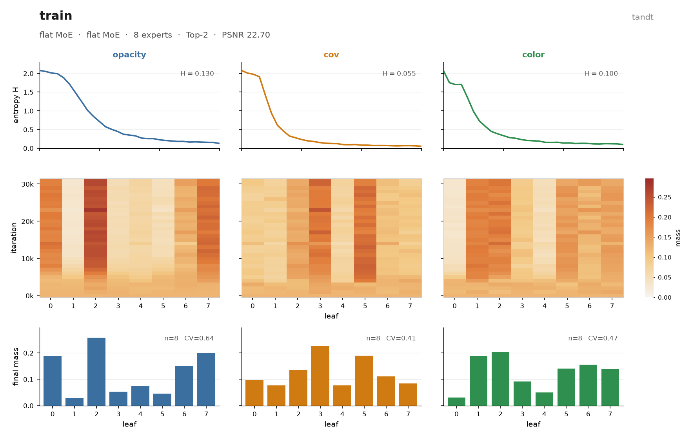</a>
<a href="by_method/tandt/train/moe_tree.png">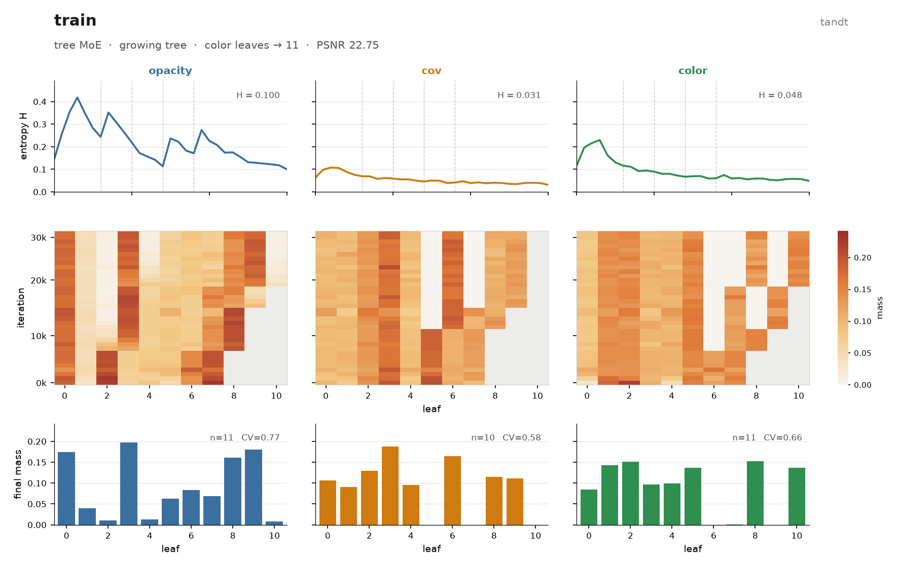</a>

### truck

PSNR: baseline 25.90 · flat MoE 26.04 · tree MoE 26.30

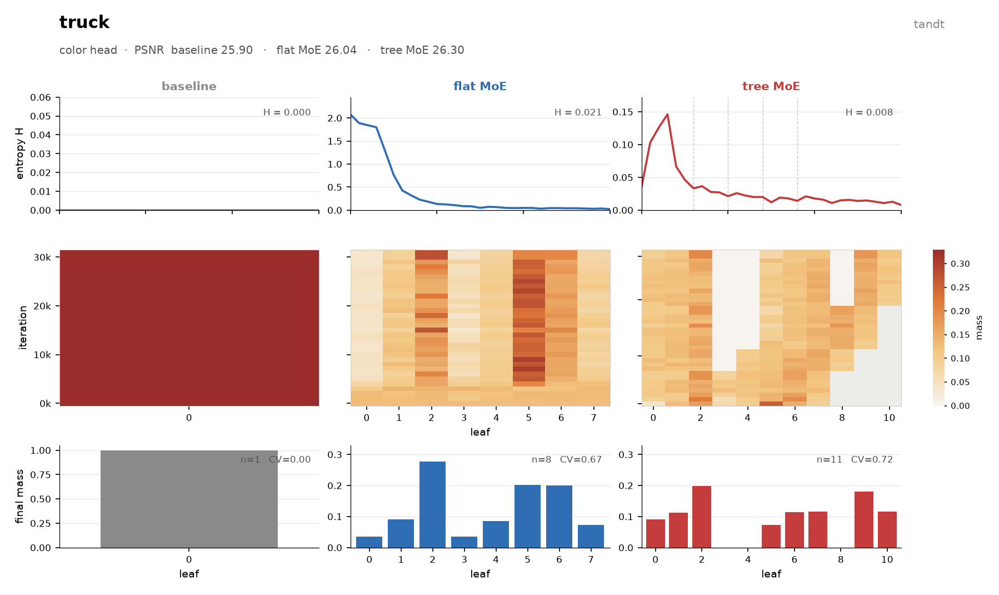

**This scene.** PSNR 25.90 / 26.04 / 26.30 (Δ vs baseline +0.14 / +0.41). Color-head final *H* = 0.021 (8 leaves) vs 0.008 (11 leaves); CV = 0.67 vs 0.72. Best PSNR: tree MoE. tree routing is nearly deterministic (H=0.008); tree ends with at least one unused color leaf (parent split, mass moved to children).

opacity / cov / color pages

Same three panels, now one column per **head** (opacity, covariance, color) for a single method. Use these when color-only is not enough — opacity often stays higher-entropy than color, and covariance usually collapses first.

<a href="by_method/tandt/truck/moe.png">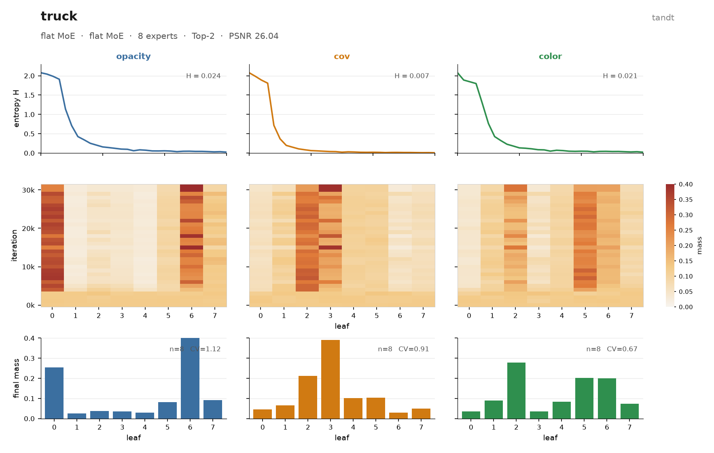</a>
<a href="by_method/tandt/truck/moe_tree.png">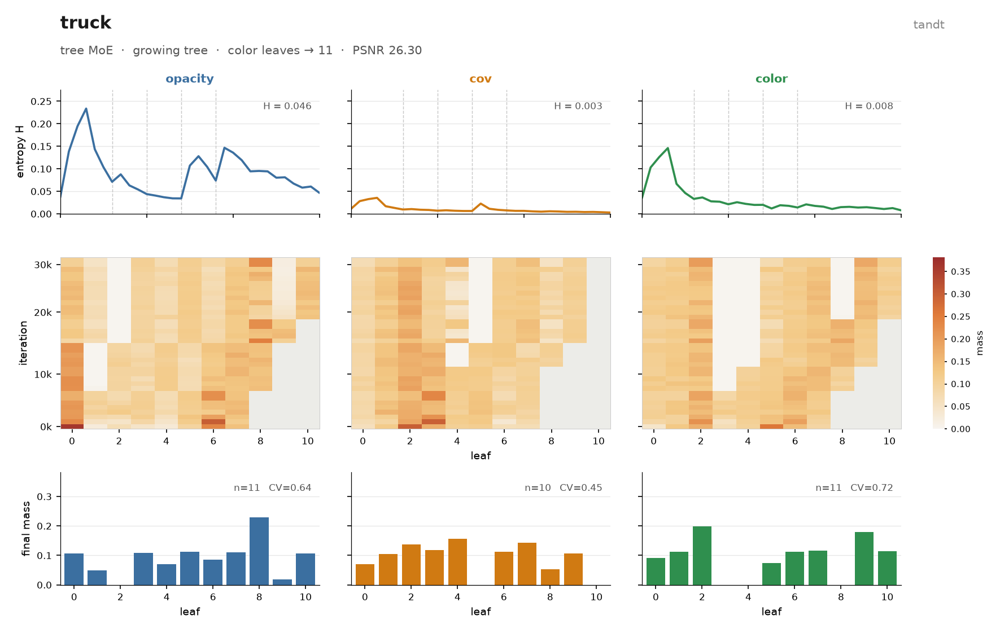</a>

## db — per scene

### drjohnson

PSNR: baseline 29.64 · flat MoE 29.74 · tree MoE 29.86

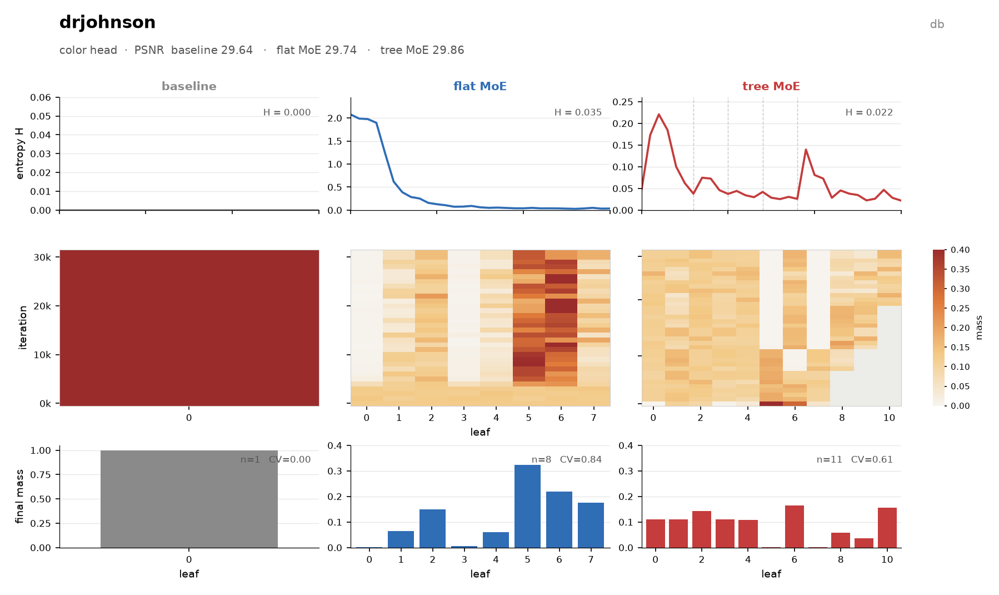

**This scene.** PSNR 29.64 / 29.74 / 29.86 (Δ vs baseline +0.09 / +0.22). Color-head final *H* = 0.035 (8 leaves) vs 0.022 (11 leaves); CV = 0.84 vs 0.61. Best PSNR: tree MoE.

opacity / cov / color pages

Same three panels, now one column per **head** (opacity, covariance, color) for a single method. Use these when color-only is not enough — opacity often stays higher-entropy than color, and covariance usually collapses first.

<a href="by_method/db/drjohnson/moe.png">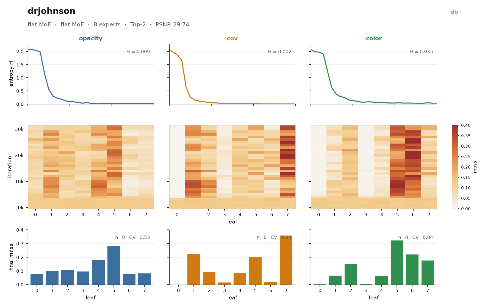</a>
<a href="by_method/db/drjohnson/moe_tree.png">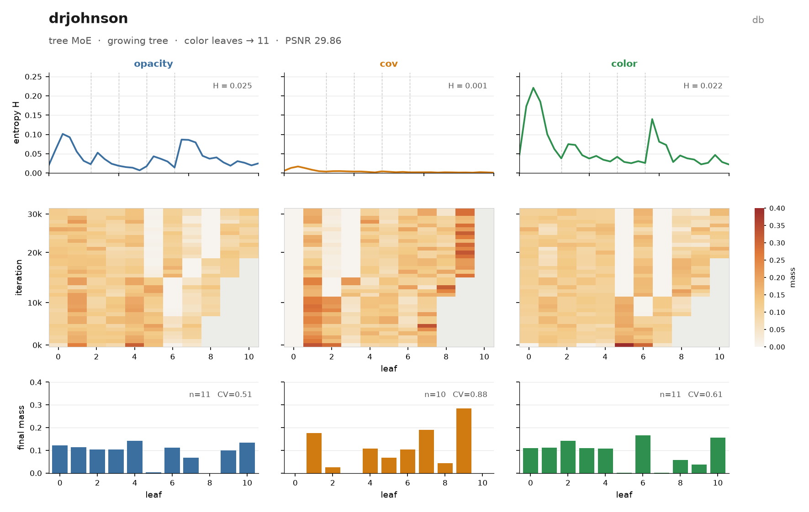</a>

### playroom

PSNR: baseline 30.83 · flat MoE 31.02 · tree MoE 31.14

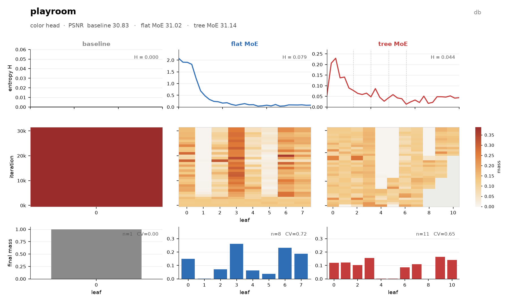

**This scene.** PSNR 30.83 / 31.02 / 31.14 (Δ vs baseline +0.19 / +0.31). Color-head final *H* = 0.079 (8 leaves) vs 0.044 (11 leaves); CV = 0.72 vs 0.65. Best PSNR: tree MoE. flat MoE keeps unusually high final entropy (H=0.079); tree ends with at least one unused color leaf (parent split, mass moved to children).

opacity / cov / color pages

Same three panels, now one column per **head** (opacity, covariance, color) for a single method. Use these when color-only is not enough — opacity often stays higher-entropy than color, and covariance usually collapses first.

<a href="by_method/db/playroom/moe.png">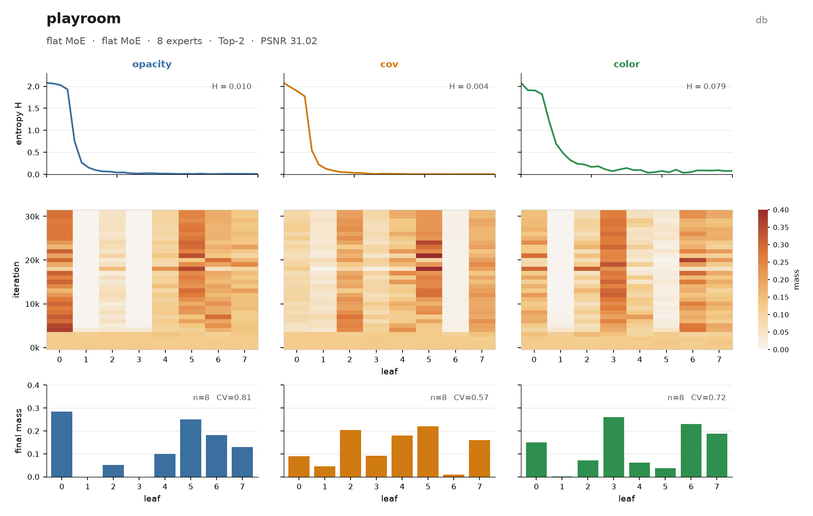</a>
<a href="by_method/db/playroom/moe_tree.png">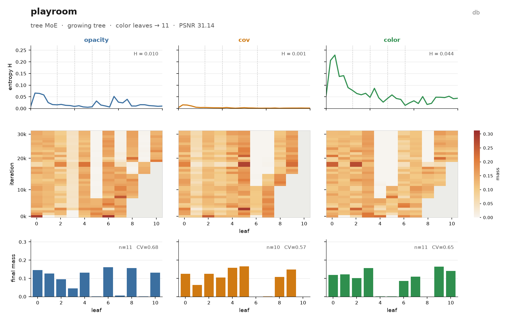</a>

## nerfsynthetic — per scene

### chair

PSNR: baseline 35.01 · flat MoE 34.90 · tree MoE 35.19

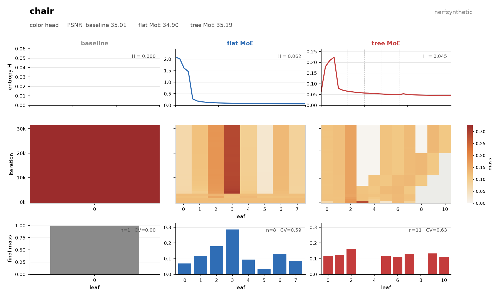

**This scene.** PSNR 35.01 / 34.90 / 35.19 (Δ vs baseline -0.11 / +0.18). Color-head final *H* = 0.062 (8 leaves) vs 0.045 (11 leaves); CV = 0.59 vs 0.63. Best PSNR: tree MoE. tree ends with at least one unused color leaf (parent split, mass moved to children).

opacity / cov / color pages

Same three panels, now one column per **head** (opacity, covariance, color) for a single method. Use these when color-only is not enough — opacity often stays higher-entropy than color, and covariance usually collapses first.

<a href="by_method/nerfsynthetic/chair/moe.png">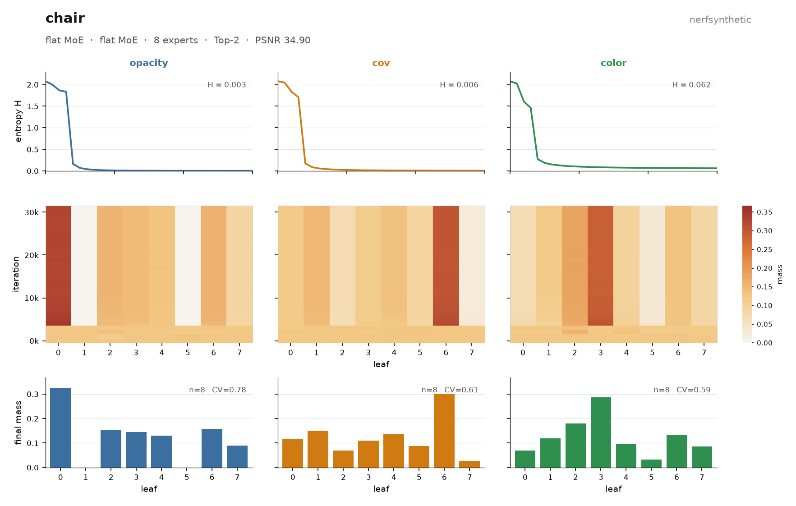</a>
<a href="by_method/nerfsynthetic/chair/moe_tree.png">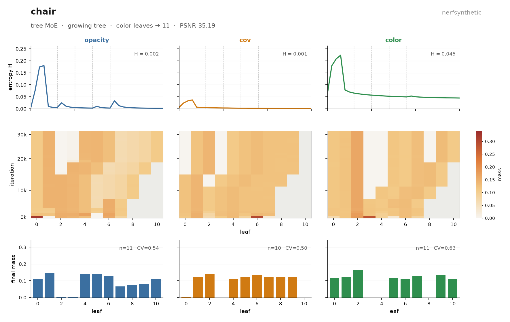</a>

### drums

PSNR: baseline 26.22 · flat MoE 26.16 · tree MoE 26.33

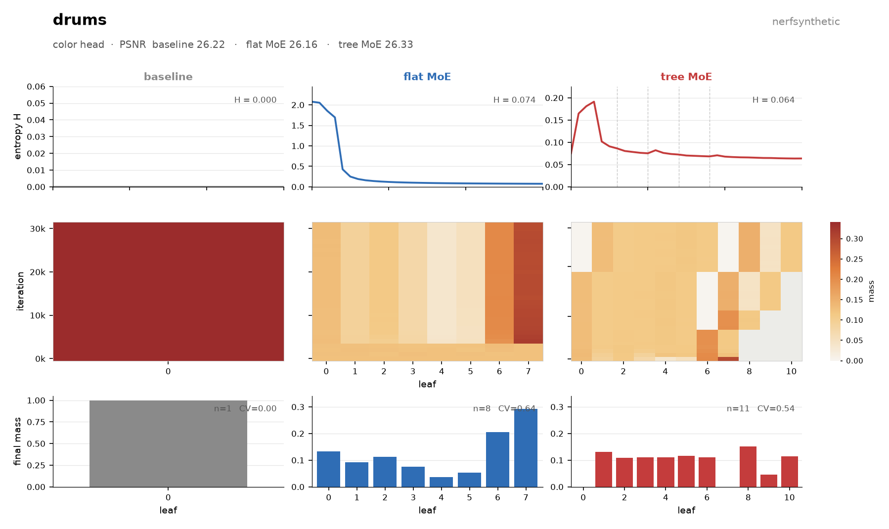

**This scene.** PSNR 26.22 / 26.16 / 26.33 (Δ vs baseline -0.07 / +0.11). Color-head final *H* = 0.074 (8 leaves) vs 0.064 (11 leaves); CV = 0.64 vs 0.54. Best PSNR: tree MoE. flat MoE keeps unusually high final entropy (H=0.074); tree ends with at least one unused color leaf (parent split, mass moved to children).

opacity / cov / color pages

Same three panels, now one column per **head** (opacity, covariance, color) for a single method. Use these when color-only is not enough — opacity often stays higher-entropy than color, and covariance usually collapses first.

<a href="by_method/nerfsynthetic/drums/moe.png">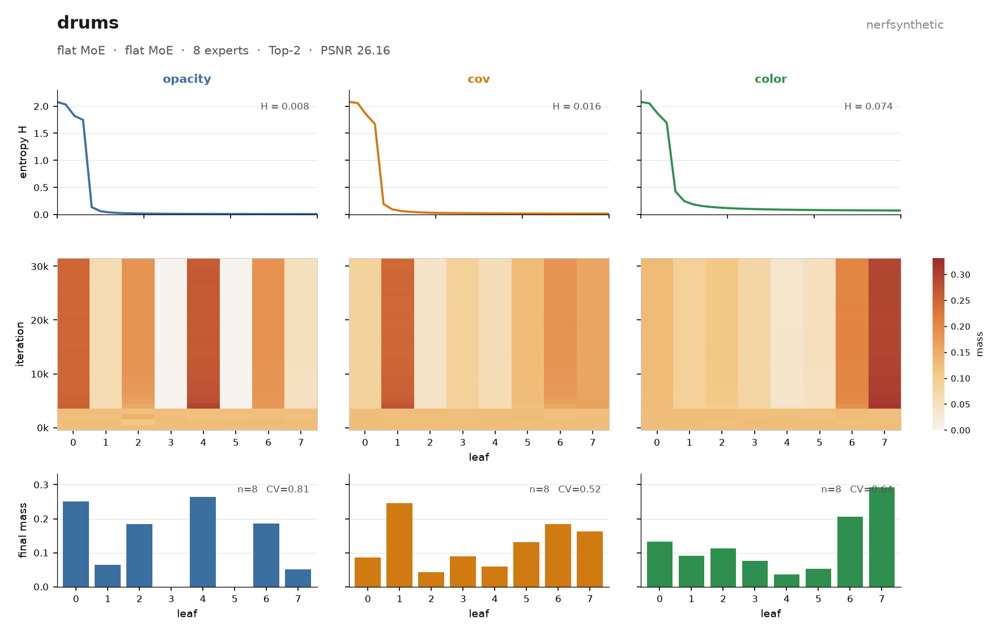</a>
<a href="by_method/nerfsynthetic/drums/moe_tree.png">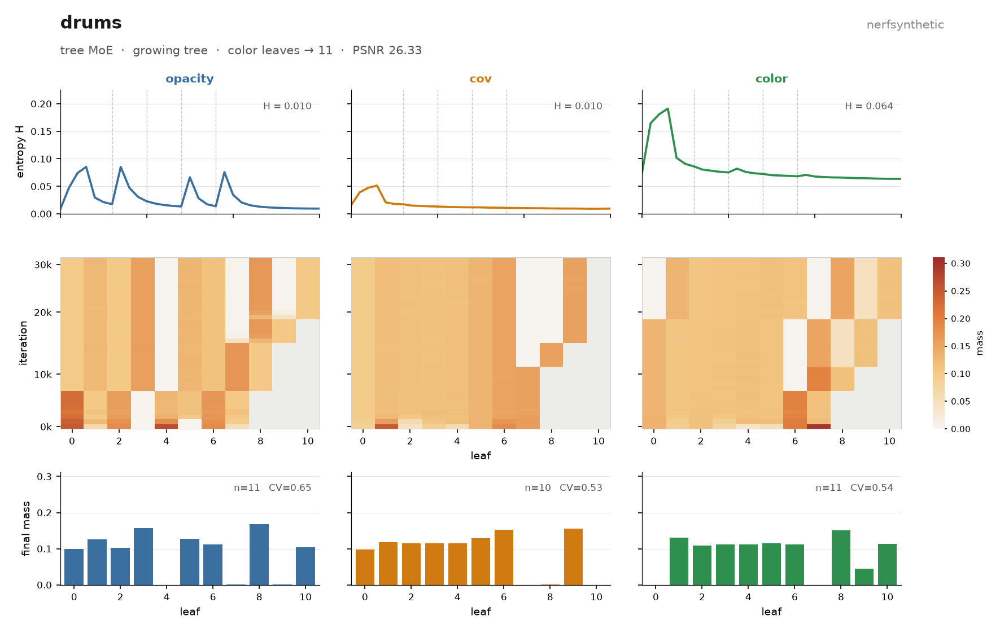</a>

### ficus

PSNR: baseline 34.90 · flat MoE 34.20 · tree MoE 34.60

**This scene.** PSNR 34.90 / 34.20 / 34.60 (Δ vs baseline -0.70 / -0.30). Color-head final *H* = 0.027 (8 leaves) vs 0.018 (11 leaves); CV = 0.73 vs 0.63. Best PSNR: baseline. tree ends with at least one unused color leaf (parent split, mass moved to children).

opacity / cov / color pages

Same three panels, now one column per **head** (opacity, covariance, color) for a single method. Use these when color-only is not enough — opacity often stays higher-entropy than color, and covariance usually collapses first.

### hotdog

PSNR: baseline 37.85 · flat MoE 37.74 · tree MoE 38.09

**This scene.** PSNR 37.85 / 37.74 / 38.09 (Δ vs baseline -0.11 / +0.24). Color-head final *H* = 0.049 (8 leaves) vs 0.035 (11 leaves); CV = 0.71 vs 0.62. Best PSNR: tree MoE. tree ends with at least one unused color leaf (parent split, mass moved to children).

opacity / cov / color pages

Same three panels, now one column per **head** (opacity, covariance, color) for a single method. Use these when color-only is not enough — opacity often stays higher-entropy than color, and covariance usually collapses first.

### lego

PSNR: baseline 35.37 · flat MoE 35.52 · tree MoE 35.86

**This scene.** PSNR 35.37 / 35.52 / 35.86 (Δ vs baseline +0.15 / +0.49). Color-head final *H* = 0.065 (8 leaves) vs 0.050 (11 leaves); CV = 0.68 vs 0.63. Best PSNR: tree MoE. tree ends with at least one unused color leaf (parent split, mass moved to children).

opacity / cov / color pages

Same three panels, now one column per **head** (opacity, covariance, color) for a single method. Use these when color-only is not enough — opacity often stays higher-entropy than color, and covariance usually collapses first.

### materials

PSNR: baseline 30.37 · flat MoE 30.17 · tree MoE 30.53

**This scene.** PSNR 30.37 / 30.17 / 30.53 (Δ vs baseline -0.20 / +0.16). Color-head final *H* = 0.054 (8 leaves) vs 0.041 (11 leaves); CV = 0.65 vs 0.64. Best PSNR: tree MoE. tree ends with at least one unused color leaf (parent split, mass moved to children).

opacity / cov / color pages

Same three panels, now one column per **head** (opacity, covariance, color) for a single method. Use these when color-only is not enough — opacity often stays higher-entropy than color, and covariance usually collapses first.

### mic

PSNR: baseline 36.50 · flat MoE 36.12 · tree MoE 36.58

**This scene.** PSNR 36.50 / 36.12 / 36.58 (Δ vs baseline -0.37 / +0.08). Color-head final *H* = 0.037 (8 leaves) vs 0.026 (11 leaves); CV = 0.62 vs 0.62. Best PSNR: tree MoE. tree ends with at least one unused color leaf (parent split, mass moved to children).

opacity / cov / color pages

Same three panels, now one column per **head** (opacity, covariance, color) for a single method. Use these when color-only is not enough — opacity often stays higher-entropy than color, and covariance usually collapses first.

### ship

PSNR: baseline 31.41 · flat MoE 31.26 · tree MoE 31.40

**This scene.** PSNR 31.41 / 31.26 / 31.40 (Δ vs baseline -0.14 / -0.00). Color-head final *H* = 0.042 (8 leaves) vs 0.037 (11 leaves); CV = 0.57 vs 0.67. Best PSNR: baseline. tree ends with at least one unused color leaf (parent split, mass moved to children).

opacity / cov / color pages

Same three panels, now one column per **head** (opacity, covariance, color) for a single method. Use these when color-only is not enough — opacity often stays higher-entropy than color, and covariance usually collapses first.

