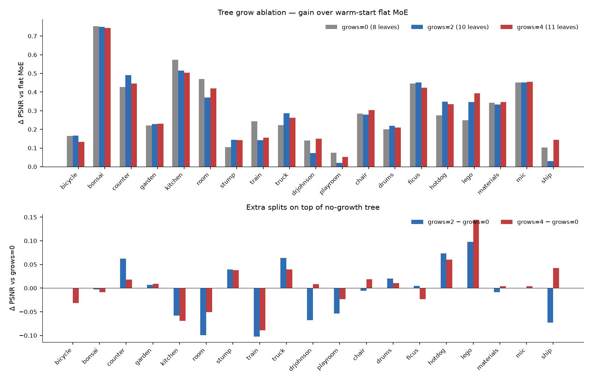

# Tree grow ablation (`moe_max_total_grows`)

Sweep of how many leaf splits the tree is allowed after warm-start from a finished flat MoE run. Schedule is fixed: grow checks at 6k / 10k / 14k / 18k.

| Setting | `moe_max_total_grows` | Typical color leaves at 30k |
|---|---:|---:|
| grows=0 | 0 | 8 (same as flat MoE; no splits) |
| grows=2 | 2 | 10 |
| grows=4 | 4 | 11 (canonical `moe_tree`) |

**19 scenes × 3 runs = 57 trainings**, all finished.

- Command: `bash sweep.sh --suite mip360,tandt,db,nerf --tree-grows 0,2,4 -g 0`
- Run dirs: `outputs/<dataset>/<scene>/ablate_grows{0,2,4}/<timestamp>/`
- Log: `sweep_logs/ablate_tree_all_scenes.out`
- Numbers: [ablate_tree_grows_all_scenes.csv](ablate_tree_grows_all_scenes.csv)

## Takeaway

Almost all of the gain over flat MoE is already present at **grows=0** (tree recipe + continued training from the MoE checkpoint, but no splits). Extra splits change PSNR by a few hundredths of a dB on average.

| | n | flat MoE | grows=0 | grows=2 | grows=4 | Δ g4−g0 |
|---|---:|---:|---:|---:|---:|---:|
| **all scenes** | 19 | 30.606 | 30.908 | 30.902 | **30.913** | +0.005 |
| mipnerf360 | 7 | 29.421 | **29.809** | 29.801 | 29.795 | −0.014 |
| tandt | 2 | 24.365 | **24.598** | 24.579 | 24.573 | −0.025 |
| db | 2 | 30.378 | **30.486** | 30.425 | 30.479 | −0.007 |
| nerfsynthetic | 8 | 33.259 | 33.552 | 33.566 | **33.585** | +0.033 |

Δ vs flat MoE (all scenes): grows=0 **+0.302**, grows=2 **+0.297**, grows=4 **+0.308**.

Best of {0, 2, 4} by scene: grows=0 on 5, grows=2 on 7, grows=4 on 7. Growing helps NeRF-Synthetic a little; on mipnerf360 / Tanks&Temples / Deep Blending, grows=0 is as good or slightly better.

**Figure.** Top: PSNR minus the matching flat MoE run. Bottom: extra splits versus the no-growth tree. Most bars in the top panel are positive (~0.1–0.7 dB). Bottom-panel bars sit near zero.

## Per-scene PSNR

Best of grows=0/2/4 is **bold**. Δ is grows=4 minus grows=0.

| Scene | flat MoE | grows=0 | grows=2 | grows=4 | Δ g4−g0 | best |
|---|---:|---:|---:|---:|---:|:---:|
| bicycle | 25.268 | 25.433 | **25.433** | 25.401 | −0.032 | g2 |
| bonsai | 33.071 | **33.823** | 33.820 | 33.814 | −0.009 | g0 |
| counter | 29.658 | 30.086 | **30.148** | 30.104 | +0.018 | g2 |
| garden | 27.436 | 27.657 | 27.664 | **27.667** | +0.009 | g4 |
| kitchen | 31.713 | **32.286** | 32.227 | 32.216 | −0.069 | g0 |
| room | 32.142 | **32.612** | 32.513 | 32.561 | −0.051 | g0 |
| stump | 26.661 | 26.765 | **26.805** | 26.803 | +0.038 | g2 |
| train | 22.695 | **22.939** | 22.837 | 22.850 | −0.089 | g0 |
| truck | 26.035 | 26.257 | **26.321** | 26.297 | +0.040 | g2 |
| drjohnson | 29.736 | 29.876 | 29.808 | **29.885** | +0.009 | g4 |
| playroom | 31.021 | **31.096** | 31.042 | 31.073 | −0.023 | g0 |
| chair | 34.900 | 35.183 | 35.178 | **35.202** | +0.019 | g4 |
| drums | 26.156 | 26.356 | **26.376** | 26.366 | +0.010 | g2 |
| ficus | 34.196 | 34.642 | **34.647** | 34.618 | −0.024 | g2 |
| hotdog | 37.744 | 38.019 | **38.093** | 38.080 | +0.060 | g2 |
| lego | 35.519 | 35.769 | 35.866 | **35.913** | +0.144 | g4 |
| materials | 30.167 | 30.509 | 30.501 | **30.513** | +0.004 | g4 |
| mic | 36.125 | 36.575 | 36.576 | **36.579** | +0.004 | g4 |
| ship | 31.263 | 31.365 | 31.292 | **31.407** | +0.042 | g4 |

Largest extra-split gain: **lego** (+0.144 from g0 to g4). Largest extra-split drop: **train** (−0.089) and **kitchen** (−0.069).

## Routing at 30k (color head)

Leaf counts are the same on every scene: 8 / 10 / 11. Sample entropy *H* barely moves with extra splits (still near 0). Utilization CV rises as the tree grows, because mass that used to sit on one parent is split onto children.

Full columns: [ablate_tree_grows_all_scenes.csv](ablate_tree_grows_all_scenes.csv). Canonical `moe_tree` routing plots (grows=4) live in [INDEX.md](INDEX.md).
