# Dynamic tree growth (ASCII)

Text + PNG timelines parsed from `routing_analysis.json` (`heads.<head>.tree`).
Each block: iteration, grow event, leaf count, then an indented tree.
Leaf lines show routing mass (%). `*` = leaf split at that step.

## mipnerf360
### bicycle

Plain text: [bicycle__color__tree_growth.txt](bicycle__color__tree_growth.txt)

### bonsai

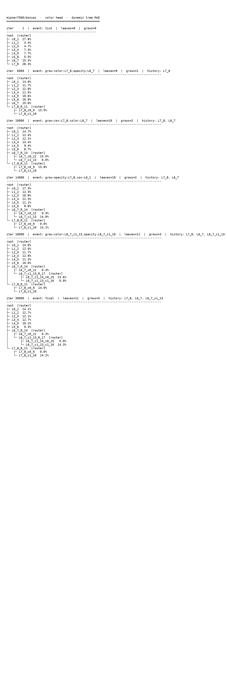

Plain text: [bonsai__color__tree_growth.txt](bonsai__color__tree_growth.txt)

### counter

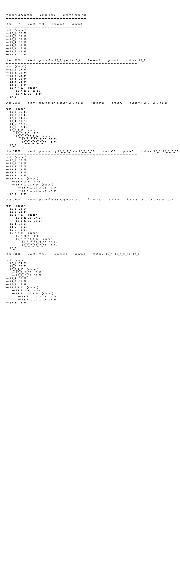

Plain text: [counter__color__tree_growth.txt](counter__color__tree_growth.txt)

### garden

Plain text: [garden__color__tree_growth.txt](garden__color__tree_growth.txt)

### kitchen

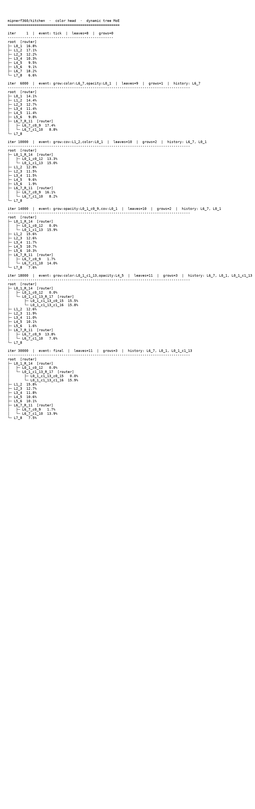

Plain text: [kitchen__color__tree_growth.txt](kitchen__color__tree_growth.txt)

### room

Plain text: [room__color__tree_growth.txt](room__color__tree_growth.txt)

### stump

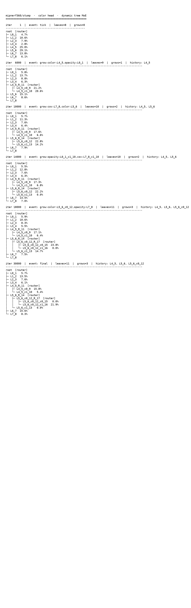

Plain text: [stump__color__tree_growth.txt](stump__color__tree_growth.txt)

## tandt
### train

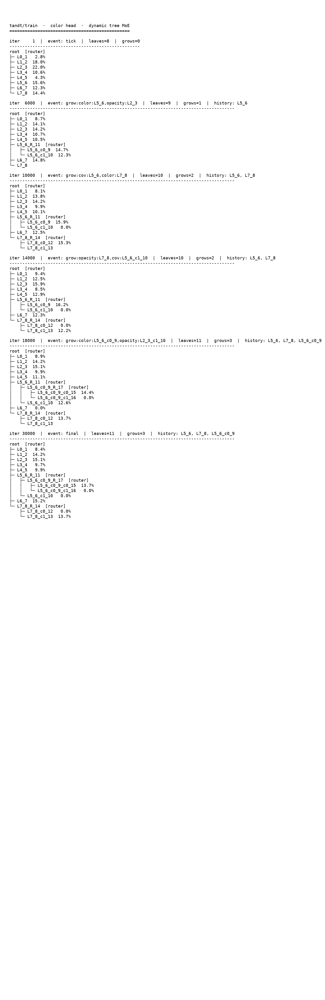

Plain text: [train__color__tree_growth.txt](train__color__tree_growth.txt)

### truck

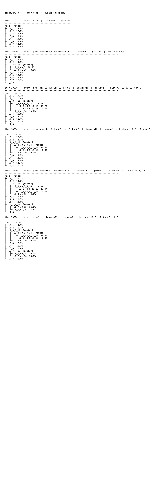

Plain text: [truck__color__tree_growth.txt](truck__color__tree_growth.txt)

## db
### drjohnson

Plain text: [drjohnson__color__tree_growth.txt](drjohnson__color__tree_growth.txt)

### playroom

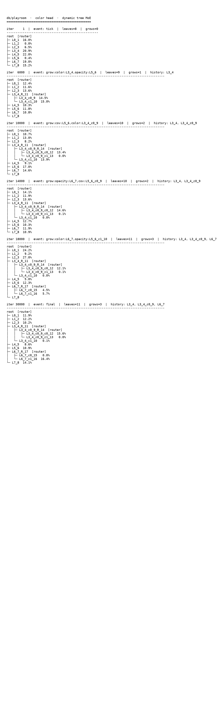

Plain text: [playroom__color__tree_growth.txt](playroom__color__tree_growth.txt)

## nerfsynthetic
### chair

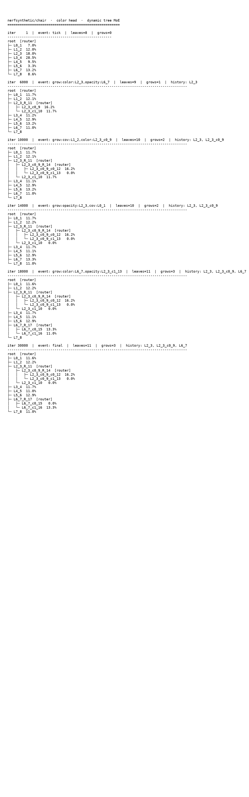

Plain text: [chair__color__tree_growth.txt](chair__color__tree_growth.txt)

### drums

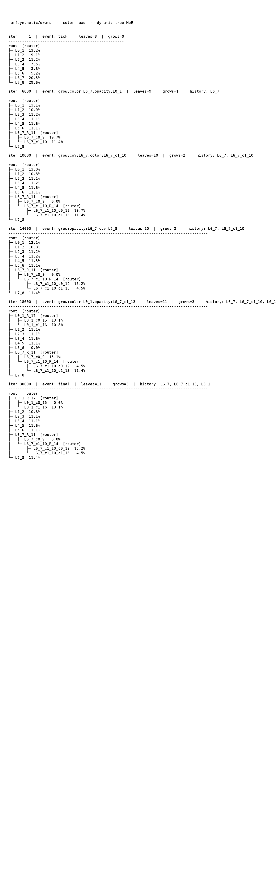

Plain text: [drums__color__tree_growth.txt](drums__color__tree_growth.txt)

### ficus

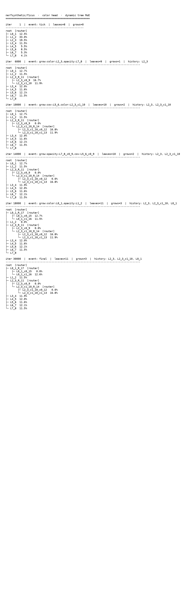

Plain text: [ficus__color__tree_growth.txt](ficus__color__tree_growth.txt)

### hotdog

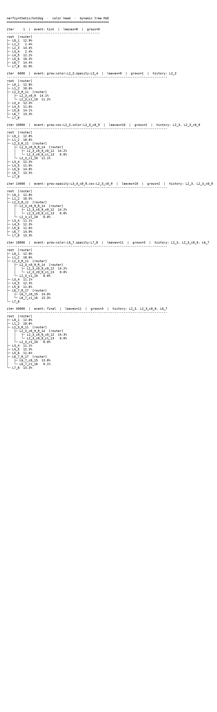

Plain text: [hotdog__color__tree_growth.txt](hotdog__color__tree_growth.txt)

### lego

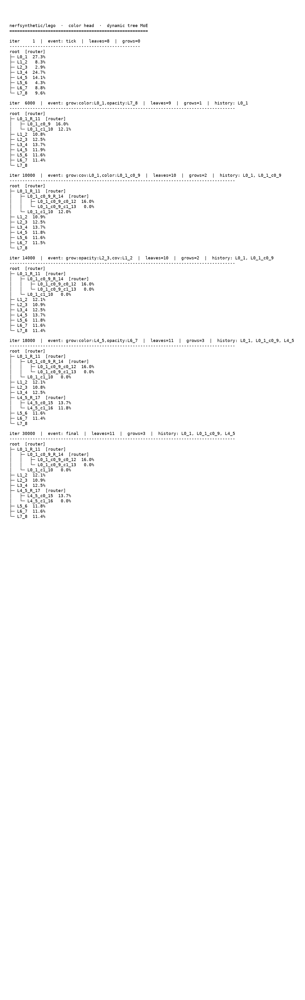

Plain text: [lego__color__tree_growth.txt](lego__color__tree_growth.txt)

### materials

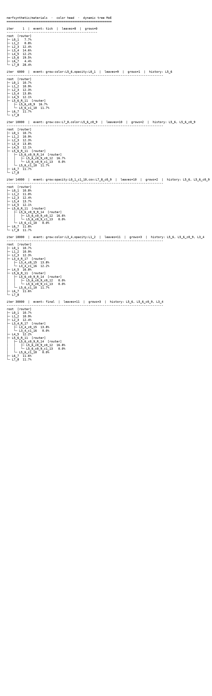

Plain text: [materials__color__tree_growth.txt](materials__color__tree_growth.txt)

### mic

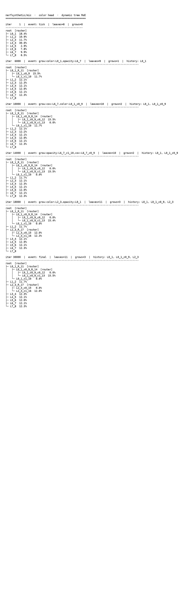

Plain text: [mic__color__tree_growth.txt](mic__color__tree_growth.txt)

### ship

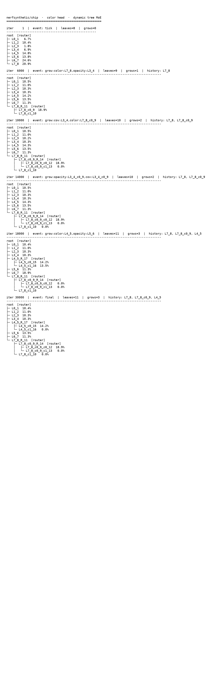

Plain text: [ship__color__tree_growth.txt](ship__color__tree_growth.txt)
